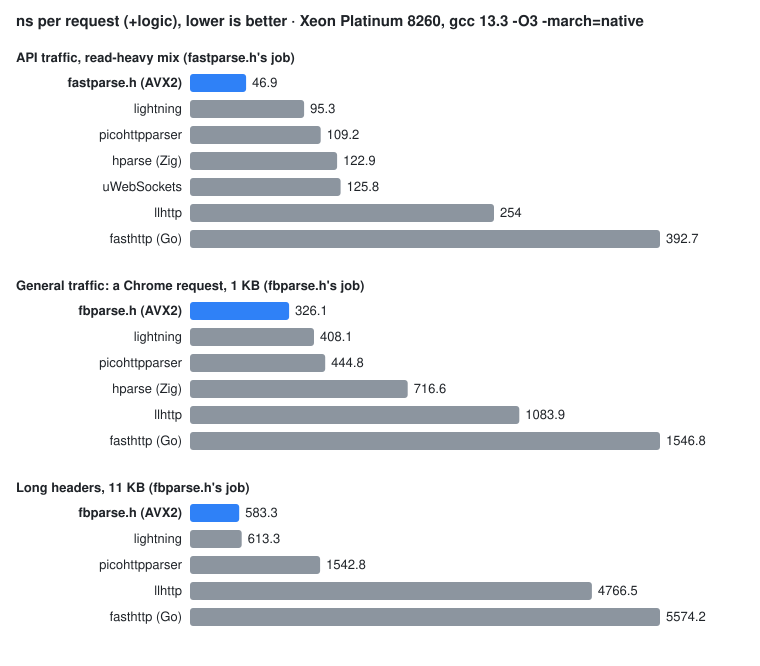
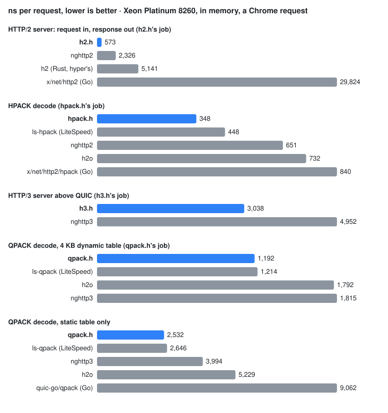

# cursed-http


[](https://app.codspeed.io/public/cursed-http?utm_source=badge)

*Formerly cursed-http-parser. Links to the old name redirect here.*

Fast HTTP/1.1 request parsers in C, built on SIMD bitmasks (AVX2, AVX-512, NEON, with a scalar fallback).
They are header-only, stateless and never allocate. Alongside them are header-only, sans-IO **HTTP/2, HTTP/3
and QUIC** server engines ([below](#http2-http3-and-quic)).

This repository holds three single-header HTTP/1.1 parsers plus a learning mode:
- **[`fastparse.h`](include/fastparse.h)**, a fast path for *your* API. Its routes are generated from a JSON spec,
  and it hands back the route, the numeric id, the `Bearer` token and the body framing directly.
- **`fast_parse_learn()`**, the learning mode of fastparse.h. It learns each route's most common header layout at
  runtime and checks later requests against that layout, with results identical to `fast_parse`.
- **`fast_parse_tmpl()`**, a second learning mode that needs no spec at all. It learns whole-request templates from
  the traffic (constant bytes plus variable slots for the path and header values) and matches later requests with
  vector compares, with results identical to `fast_parse`. *In development:* see
  [Learned request templates](#learned-request-templates).
- **[`fbparse.h`](include/fbparse.h)**, a general parser with picohttpparser's API and exactly its results.
- **[`batchparse.h`](include/batchparse.h)**, which parses many connections' requests in one lane-parallel call.

**Why it exists.** A server that knows its own routes doesn't need a general parser on the hot path. fastparse.h
matches the API's request lines directly, pulls out the few things the handler needs, and passes anything unusual
to fbparse.h, a general parser that gives picohttpparser's exact results, faster. batchparse.h goes one step further
for event loops that wake up with many connections ready: one call parses a request from each of them.

**Status.** The parsers are complete for HTTP/1.1 requests and tested on x86-64 (AVX2, AVX-512) and AArch64 (NEON).
The HTTP/2, HTTP/3 and QUIC engines are newer: server side only, with the limits listed in [H2H3.md](H2H3.md). There are no
tagged releases yet; `main` is the current version. It has not had an external security review (see
[SECURITY.md](SECURITY.md)).

**Proven, tested, or neither.** Nothing here is formally verified. The parsers are tested: differentially against
picohttpparser on millions of generated and mutated inputs per run, against 298 third-party conformance cases, with
libFuzzer, Hypothesis properties, ASan/UBSan, and planted bugs (`make mutants`) that each must make a test fail.
"Identical to picohttpparser" below means no difference has been found on those inputs, not that one can't exist.
Details: [Correctness](#correctness).

## Features

* **Bitmask parsing.** One ISA-specific step classifies 64 bytes into bitmasks; everything else is portable C on
  those masks.
* **Stateless, zero-copy, no allocation.** Results point into your buffer, and partial requests just return
  "need more".
* **Spec-generated routing.** `gen/httpgen.py` compiles your routes into canonical request-line templates matched
  with 64-bit compares. It can be profile-guided, and the profile contributes decisions only, never bytes.
* **Declines what it doesn't understand.**
  - Anything unusual returns `FP_FALLBACK`: HTTP/1.0, chunked, obs-fold, a bare CR, an odd Content-Length.
  - `fbparse.h` takes those requests with picohttpparser's exact accept/reject.
  - 298 third-party conformance cases (llhttp, HTTP Garden, picohttpparser, httparse) give 0 framing mismatches.
* **A drop-in for picohttpparser.** `fb_parse_request` has `phr_parse_request`'s signature and returns
  identical results on every input tested so far, including the -1 vs -2 decisions. Millions of differential inputs check that
  on every run.
* **Tested hard.** Differential fuzzing against picohttpparser, ASan/UBSan, planted-bug (mutation) checks, and
  real AVX-512 runs on a Xeon.

## Are we fast?



Intel Xeon Platinum 8260 (Cascade Lake), Ubuntu 24.04, kernel 6.8, gcc 13.3 `-O3 -march=native`, ns per request.
Each competitor is built at least as aggressively as its own project builds it (see
[Build flags](#build-flags-of-the-comparisons)). "+logic" means the general parser plus the same routing / Bearer /
Content-Length work fastparse does; that's the like-for-like column. Every parser + logic must agree with
fastparse on every request before it's timed.

**API traffic** (read-heavy mix, +logic):

| parser | ns/req | |
|---|---|---|
| **fastparse.h** (AVX2) | **46.9** | 1× |
| fastparse.h, generated from the spec + profile | 45.1 | 0.96× |
| fbparse.h, our general parser ³ | — | 2.0× slower |
| lightning (C, AVX2/SSE4.2) | 95.3 | 2.0× slower |
| picohttpparser (SSE4.2) | 109.2 | 2.3× slower |
| hparse (Zig) ¹ | 122.9 | 2.6× slower |
| uWebSockets 20.80 (C++) | 125.8 | 2.7× slower |
| httparse 1.10.1 (Rust, AVX2) ¹ | 150.4 | 3.2× slower |
| llhttp 9.4.3 (Node.js) | 254.0 | 5.4× slower |
| fasthttp 1.76 (Go) ² | 392.7 | 8.4× slower |
| http-parser 2.9.4 (Node.js, legacy) | 397.7 | 8.5× slower |

**General traffic** (fbparse.h against the general parsers, +logic). fbparse.h is the fastest general parser on every
corpus here, and on the API mix above (³):

| corpus | **fbparse.h** | lightning | picohttpparser | httparse ¹ | llhttp | hparse ¹ | fasthttp ² | http-parser |
|---|---|---|---|---|---|---|---|---|
| curl (181 B) | **95.1** | 113.9 | 123.9 | 177.1 | 319.2 | 157.4 | 485.1 | 614.3 |
| Chrome (1,040 B) | **326.1** | 408.1 | 444.8 | 760.2 | 1,083.9 | 716.6 | 1,546.8 | 2,974.3 |
| Firefox (813 B) | **292.8** | 364.0 | 394.3 | 654.2 | 943.0 | 572.5 | 1,365.9 | 2,433.6 |
| long headers (11 KB) | **583.3** | 613.3 | 1,542.8 | 3,024.5 | 4,766.5 | 3,252.7 | 5,574.2 | 26,050.3 |

**Raw parse, fbparse.h vs the fastest competitor (lightning).** These are medians over 8 code layouts × 3 rounds of
back-to-back pairs (see [Method](#method)):

| | k6 | gocli | curl | Chrome | Firefox | HTTP/1.0 | long headers | chunked |
|---|---|---|---|---|---|---|---|---|
| fbparse.h vs lightning | **−12.7%** | **−12.5%** | **−12.7%** | **−15.0%** | **−8.6%** | **−10.9%** | **−3.1%** | **−15.3%** |
| fbparse.h vs picohttpparser | **−18.4%** | **−17.2%** | **−20.2%** | **−25.7%** | **−18.2%** | **−21.0%** | **−62.3%** | **−21.5%** |
| fbparse.h vs httparse (Rust, AVX2) ¹ | **−50.2%** | **−51.6%** | **−48.7%** | **−58.9%** | **−52.4%** | **−46.9%** | **−80.8%** | **−53.7%** |

Lightning validates nothing: no token characters, no control bytes in values. fbparse.h checks every byte as
picohttpparser does, and is still faster on every corpus, raw and with the routing work added.

On an Apple M5 Pro, fbparse.h is the fastest general parser on every corpus, raw and +logic, against picohttpparser,
two Armv8-A NEON forks of it, lightning, llhttp, uWebSockets and http-parser. fastparse.h does the API mix in 14.2 ns,
against 40.5 for the best general parser.

¹ hparse needs Zig 0.15, which the Xeon test machine doesn't have, so its numbers are from an earlier run of the same harness.
httparse is from a separate Xeon run with that machine's rustc 1.94.0. It was built like its own bench profile plus
`target-cpu=native`, so its compile-time AVX2 path is on, and it passed the same correctness gate. Its vs-fbparse
row uses the same layout-randomised pairs, 8 layouts × 2 rounds.
³ fbparse.h is from a later run of the same harness (Xeon exp1385, 3 rounds, the gate passed) with buffers twice as
far apart, which puts every parser's numbers higher, so only same-run ratios are shown. In that run, on the gocli -gzip
mix +logic: fbparse.h 107.7 ns, lightning 114.2, picohttpparser 132.8, uWebSockets 138.7, llhttp 259.2, fastparse.h
54.6. On the k6 and gocli corpora too, it is the fastest general parser: 99.6 vs 116.8 (lightning) and 81.7 vs 88.1.
² fasthttp is Go. It is measured by its own harness on the same request bytes (`make compare-go`): it parses with
`RequestHeader.Read`, as its server does, and its "+logic" is the same routing in Go. There is no shared correctness
gate across languages; it accepted every request.

- **batchparse.h** at 16 connections per call is 4–7% faster than 16 `fast_parse` calls on mixed traffic and
  7–13% faster on GET-only traffic. 16 picohttpparser calls are about 2.2× slower.

Reproduce:

```bash
make bench
```

This runs pico and llhttp, which are vendored. To add uWebSockets, lightning, http-parser, the Armv8-A pico forks,
httparse (rustc) and hparse (zig 0.15), fetched at pinned commits:

```bash
make compare-all
```

fasthttp needs Go 1.26 or newer:

```bash
make compare-go
```

The full tables and the method are under [Benchmarks](#benchmarks).

## HTTP/2, HTTP/3 and QUIC

Server-side engines in the same style: header-only, sans-IO (bytes in, events out, bytes to send), and the
caller owns the memory. They bring no sockets or event loop; you feed them what you read and write out what
they produce. The full design, test list, limits and benchmarks are in **[H2H3.md](H2H3.md)**.

| header | what |
|---|---|
| [`hfield.h`](include/hfield.h) | SIMD header-field validation (AVX-512, AVX2, NEON, SWAR), the Huffman codec, branchless QUIC varints |
| [`hpack.h`](include/hpack.h) | HPACK (RFC 7541) decoder with a dynamic table; static-only response encoder |
| [`hreq.h`](include/hreq.h) | request header rules shared by HTTP/2 and HTTP/3 |
| [`h2.h`](include/h2.h) | HTTP/2 server connection (RFC 9113): flow control, trailers, zero-copy bodies, backpressure |
| [`qpack.h`](include/qpack.h) | QPACK (RFC 9204) decoder with a dynamic table; static-only response encoder |
| [`h3.h`](include/h3.h) | HTTP/3 server (RFC 9114) over abstract QUIC streams, so it runs on any QUIC stack |
| [`qhp.h`](include/qhp.h) | batched QUIC header-protection masks (AES-NI, ARMv8 AES, ChaCha20 AVX2/NEON) |
| [`quic.h`](include/quic.h) | QUIC v1 server transport (RFC 9000/9001/9002); TLS 1.3 via [picotls](https://github.com/h2o/picotls) + OpenSSL libcrypto |

Everything but `quic.h` is dependency-free and never allocates. `quic.h` grows stream buffers through a
caller-supplied allocator.

### Are we fast? (HTTP/2 and HTTP/3)



Xeon Platinum 8260 (Cascade Lake), gcc 13.3 `-O3 -march=native`, ns per request, in memory: no sockets and no TLS.
Every C rival is built with the same flags (`make MARCH=-march=native`), at least as aggressively as its own release
build. Before it is timed, every decoder's output is checked field by field against the request it encodes, and every
server must answer every request. Results are from exp1393 (C) and exp1362 (Go, Rust).

**Server CPU per request**, 256 requests on one connection. The same client bytes go into each server, and each
answers `:status 200` with a 13-byte body:

| server | browser | gRPC | h2load |
|---|---|---|---|
| **`h2.h`** | **540** | **713** | **193** |
| nghttp2 1.70 | 2,326 (4.3×) | 2,427 (3.4×) | 998 (5.2×) |
| h2 0.4.20 (Rust, hyper's HTTP/2) ¹ | 5,141 (9.5×) | 5,552 (7.8×) | 2,869 (15×) |
| golang.org/x/net/http2 v0.62 (Go 1.27) ¹ | 29,824 (55×) | 29,211 (41×) | 25,267 (131×) |
| **`h3.h`** (HTTP/3 above QUIC) ² | **2,339** | **1,548** | **619** |
| nghttp3 1.18 ² | 4,890 (2.1×) | 3,213 (2.1×) | 1,400 (2.3×) |

**Header decoding** per request, warm 4 KB table:

| decoder | browser | gRPC | h2load |
|---|---|---|---|
| **`hpack.h`** | **329** | **511** | **54** |
| ls-hpack 2.3.5 (LiteSpeed) | 446 (1.4×) | 785 (1.5×) | 84 (1.6×) |
| nghttp2 1.70 | 625 (1.9×) | 1,194 (2.3×) | 135 (2.5×) |
| h2o (2026-11-01) | 734 (2.2×) | 1,387 (2.7×) | 80 (1.5×) |
| x/net/http2/hpack (Go) | 840 (2.5×) | 1,889 (3.7×) | 112 (2.1×) |
| **`qpack.h`**, dynamic table | **1,094** | **928** | **85** |
| ls-qpack 2.7.0 (LiteSpeed), dynamic | 1,206 (1.1×) | 1,069 (1.2×) | 180 (2.1×) |
| ls-qpack, dynamic, plus `qpack.h`'s field checks ⁴ | 1,474 (1.3×) | 1,247 (1.3×) | 247 (2.9×) |
| h2o, dynamic ³ | 1,786 (1.6×) | 1,760 (1.9×) | 133 (1.6×) |
| nghttp3 1.18, dynamic | 1,825 (1.7×) | 1,648 (1.8×) | 221 (2.6×) |
| **`qpack.h`**, static table only | **2,407** | **1,122** | **132** |
| ls-qpack, static only | 2,603 (1.08×) | 1,172 (1.04×) | 217 (1.6×) |
| ls-qpack, static only, plus `qpack.h`'s field checks ⁴ | 2,864 (1.2×) | 1,343 (1.2×) | 286 (2.2×) |
| nghttp3, static only | 4,050 (1.7×) | 1,962 (1.7×) | 349 (2.6×) |
| h2o, static only ³ | 5,264 (2.2×) | 2,142 (1.9×) | 303 (2.3×) |
| quic-go/qpack 0.6 (Go, static only) | 9,062 (3.8×) | 3,626 (3.2×) | 456 (3.4×) |

- **Closest race: LiteSpeed's ls-qpack.** It is 4–15% behind `qpack.h` on the browser and gRPC sets, though
  `qpack.h` checks every field against RFC 9113 and ls-qpack checks nothing. Doing the same checks in its
  callback (⁴) puts ls-qpack 1.2–1.35× behind. With no dynamic table nothing can be cached, so the checks are
  done on every field; the Huffman decoder carries the checks' byte classes in its table, so a Huffman-coded
  value that passes is not scanned a second time (exp1390).
- **`h3.h` vs nghttp3** is 2.1–2.3×. `h3_pending` used to walk all 100 stream slots on every call, and this
  benchmark's HTTP/3 harness searched its stream buffers linearly, a cost only `h3.h` paid. Both are fixed
  (exp1390); before, the margin was 1.4–1.6×.
- **Why `hpack.h` and `h2.h` win.** Each header is validated once, when it enters the dynamic table, and the
  verdict is cached. nghttp2 and nghttp3 re-check every byte of every header on every request. ls-hpack doesn't
  validate at all, and h2o validates like we do.
- **Build flags matter at this scale.** An earlier run with the Makefile's default x86 target (`-march=haswell`)
  had `qpack.h` 1–7% behind ls-qpack on the gRPC set and `hpack.h` 7% faster on the browser set.

¹ Go and Rust are measured by their own harnesses ([`bench/go-h2h3`](bench/go-h2h3),
[`bench/rust-h2`](bench/rust-h2)) on the same bytes, dumped with `bench_h2h3 --dump`. Each runs on one thread
(`GOMAXPROCS=1`, a current-thread tokio runtime) through an in-memory connection; Rust is built with fat LTO and
`target-cpu=native`. Their time includes the in-memory pipe and counting the responses, which is small next to
these numbers. Go's server also starts a goroutine per request and adds `Date` and `Content-Length` headers.
² An nghttp3 client's stream bytes, with its QPACK encoder using a 4 KB dynamic table, replayed into each server
over an emulated stream transport. QUIC itself is not included.
⁴ ls-qpack with `qpack.h`'s two per-field checks (the name's class and the RFC 9113 value rules) added to its
header callback: the same work `qpack.h` does, so this row compares like with like. Build it with
`make MARCH=-march=native CFLAGS="-O3 -DLSVAL" bench-h2h3-rivals` (its ls-qpack rows are then this one).
³ h2o's only public QPACK section decoder is its request parser, so its numbers also include h2o's request checks
and building its header vector. Its HPACK row uses the per-field decoder only.

Reproduce:

```bash
scripts/fetch-thirdparty.sh nghttp2 nghttp3 ls-hpack ls-qpack h2o
make MARCH=-march=native bench-h2h3-rivals
```

For the Go and Rust rows (Go 1.26+, cargo):

```bash
build/h2h3/bench_h2h3_rivals --dump build/h2h3/corpus
```

```bash
(cd bench/go-h2h3 && go run . ../../build/h2h3/corpus)
```

```bash
(cd bench/rust-h2 && cargo run --release -- ../../build/h2h3/corpus)
```

**Tested** against the reference implementations and real clients:
- h2spec strict mode, 147/147;
- the RFC 7541, 9204 and 9001 examples;
- differential runs against nghttp2, nghttp3 and an ngtcp2 client over a simulated lossy, reordering network;
- curl (HTTP/2) and aioquic (HTTP/3) against the example servers over real sockets;
- planted bugs, and ASan/UBSan.

Not formally verified, and not yet interop-tested against browsers.

Runnable servers: [`examples/h2_server.c`](examples/h2_server.c) (HTTP/2 over TCP, h2c) and
[`examples/h3_server.c`](examples/h3_server.c) (HTTP/3 over UDP).

```bash
scripts/fetch-thirdparty.sh nghttp2 nghttp3 h2spec picotls ngtcp2
make test-h2h3      # every HTTP/2 / HTTP/3 / QUIC test
make real-clients   # curl and aioquic against the example servers
```

## Usage

The example below reads a request from socket `sock` using `read(2)`. It parses the request with `fast_parse`,
passes anything unusual to `fbparse`, and prints what it got. It is
[`examples/read_loop.c`](examples/read_loop.c), and `make test` builds and runs it.

```c
#include "fastparse.h"
#include "fbparse.h"

char buf[8192 + 64];                       /* + 64: readable padding after the data, any contents */
int buflen = 0, ret;
req_t req;

while (1) {
    /* read the request */
    ssize_t n;
    while ((n = read(sock, buf + buflen, sizeof buf - 64 - buflen)) == -1 && errno == EINTR)
        ;
    if (n <= 0)
        return IOError;
    buflen += n;
    /* parse it: the API's canonical requests on the fast path, everything else pico-exact */
    ret = fast_parse(buf, buflen, &req);
    if (ret == FP_FALLBACK) {
        fb_info_t info;
        ret = fb_parse_req_ex(buf, buflen, &req, &info);
        if (ret == FP_FALLBACK && info.flags == FB_MINOR)
            ret = info.total;              /* HTTP/1.0: fine too */
    }
    if (ret > 0)
        break;                             /* complete request: head + body */
    if (ret == -2 || ret == FP_FALLBACK)
        return BadRequest;                 /* invalid, or chunked / odd Content-Length (or 501) */
    /* FP_NEED_MORE: request is incomplete, continue the loop */
    if (buflen == sizeof buf - 64)
        return RequestIsTooLongError;
}

printf("request is %d bytes, route %d\n", ret, req.route);
if (req.id_ok) printf("id is %lld\n", (long long)req.id);
if (req.auth)  printf("bearer token is %.*s\n", req.tok_len, req.tok);
printf("body is %d bytes at offset %d\n", req.body_len, req.body_off);
```

**Chunked bodies** (`Transfer-Encoding: chunked`). RFC 9112 (7.1) says a server must accept a valid chunked
body. `fb_parse_req_ex` reports one (`info.flags & FB_TE`); take the head length from `fb_parse_request` and decode
the rest with `fb_decode_chunked`:

```c
int body_len, used = fb_decode_chunked(buf + head, buflen - head, out, 4096, &body_len);
//   > 0: the chunked body ends at buf + head + used (a pipelined request may follow); out holds body_len bytes
//        (out is buf + head to decode in place, or a separate buffer of at least the limit, 4096 here)
//   FB_CHUNK_NEED_MORE: read more and call again (stateless)
//   FB_CHUNK_INVALID: 400 and close
//   FB_CHUNK_TOO_LARGE: over your limit (4096 here), 413 and close
```

- **Strict where request smuggling lives:** sizes are 1–16 hex digits, every line ends in CRLF, each chunk's data
  is followed by exactly CRLF, and extensions are ignored but must hold no control bytes. Trailer fields are
  refused.
- **Never more lenient than pico's decoder:** whatever it accepts, picohttpparser's `phr_decode_chunked` accepts
  with the same body and length (`tests/test_chunked.c`, `fuzz/fuzz_chunked.c`).
- **Content-Length together with chunked is the server's call:** RFC 9112 says to treat it as an error (6.3).
- **As fast as pico's decoder or faster** on the Xeon, while validating more (`build/bench_chunked`, ns per body,
  one run, in place):

  | body | `fb_decode_chunked` | `phr_decode_chunked` |
  |---|---|---|
  | 1 × 17 B | 25.5 | 27.5 |
  | 1 × 500 B | 22.1 | 22.3 |
  | 16 × 32 B | 219.3 | 230.5 |
  | 64 × 8 B | 767.0 | 784.8 |
  | 1 × 4 KB | 77.9 | 93.2 |
  | 8 × 500 B, with extensions | 264.2 | 272.2 |

  It parses each size line once. Chunk data up to 256 bytes is copied inline in 16-byte blocks, and extensions are
  checked 8 bytes at a time.

The example above answers 400 for chunked bodies, which is right only if your API documents that it refuses them.

**Many connections at once:**

```c
bp_parse(n, bufs, lens, reqs, rets);   /* rets[i] == fast_parse(bufs[i], lens[i], &reqs[i]) */
```

**As a drop-in for picohttpparser:** keep your `phr_parse_request` call, rename it to `fb_parse_request`, and use
`struct fb_header`. That struct has the same layout as `struct phr_header`.

## Installation

The parsers are header-only. Copy `include/` into your tree, then add `-march=native` (x86) or `-mcpu=native`
(ARM); see the [build matrix](#build-matrix).

For a binary that has to run on any x86-64 CPU (a package, a container image), link the dispatch library
instead. It holds every backend and picks the best one at load time ([chp.h](#chph-runtime-dispatch)):

```bash
make lib    # build/libchp.a; then #include "chp.h" and call chp_fast_parse(), chp_fb_parse_request(), ...
```

For your own routes, generate the header from your spec:

```bash
python3 gen/httpgen.py gen my_spec.json --base include/fastparse.h -o fastparse_my_api.h
```

To run the tests and benchmarks you need `cc`, `make` and `python3`:

```bash
make test
```

```bash
make bench
```

## Contents

- [HTTP/2, HTTP/3 and QUIC](#http2-http3-and-quic) (details in [H2H3.md](H2H3.md))
- [Why it's fast](#why-its-fast)
- [API](#api)
- [The spec and the generator](#the-spec-and-the-generator)
- [Build matrix](#build-matrix)
- [Build and test](#build-and-test)
- [Correctness](#correctness)
- [Benchmarks](#benchmarks)
- [Limits and semantic differences](#limits-and-semantic-differences)
- [Security](#security)
- [Acknowledgements](#acknowledgements)
- [Licence](#licence)

## Why it's fast

**fastparse.h**
- **One ISA-specific step.** Each backend has one function that turns 64 bytes into 64-bit masks. Everything
  else is shared C on masks and SWAR words.
  - AVX2: `vpcmpeqb` + `vpmovmskb`.
  - AVX-512: compares straight into `k` registers, on ymm by default.
  - NEON: `vld4q` + a `vsri` chain + `shrn #4` instead of a movemask.
  - Scalar: SWAR plus a multiply-gather.
- **End of headers from the LF mask alone.** Candidates are `lf & lf<<1` and `lf & lf<<2`, confirmed with byte
  loads. There's no CR mask.
- **Canonical request lines are matched from the first bytes.** For example `GET /posts/<digits> HTTP/1.1\r\n`
  is matched with 64-bit compares and a SWAR atoi, independent of the LF scan, so the route's branch resolves
  early. This was the biggest single win (14.4 → 10.5 ns on an Apple M5).
- **Only the header lines that matter are visited.** On GET routes only lines starting with `c`/`t` are looked
  at (`Content-Length`, `Transfer-Encoding`), found straight from a second mask: a typical GET never touches a
  header line. Routes that need `Authorization` walk every line start off the LF mask.
- **No token-character validation.** That is the main reason it beats general parsers even before their
  routing logic. It is safe for the values it returns, and it is spelled out under
  [Limits](#limits-and-semantic-differences).
- **Optional learned layout** (`fast_parse_learn`). Per route, it learns the most common header layout at
  runtime and checks later requests against it with independent compares, with identical results. It helps
  pipelined batches; it doesn't help single calls on real hardware.
- **Optional learned request templates** (`fast_parse_tmpl`), below.

**fbparse.h**
- **Same mask approach for pico's grammar.** There are four predicates: not-a-token-char (pico's
  `token_char_map` as a nibble LUT: two `pshufb`/`tbl` + AND), value end, path end, and LF.
- **Lazy classification.** Each predicate is classified per 64-byte block only when a search reaches that
  block.
- **Lines don't wait on each other.** Header line starts come straight from the LF mask, so a line doesn't wait
  for the previous line's name/value scans. That is −20% on long heads.
- **Long values stream like `memchr`.** Once a line has run past three blocks (a big cookie, a trace id), fbparse
  stops building exact masks and tests "could there be a control byte in the next 256–512 bytes?":
  - the windows are aligned to the address, so loads never split cache lines;
  - the test is two vector ops per 32 bytes: (int8)(x + 1) < 0x21 catches every control byte and DEL, and
    over-approximates on bytes ≥ 0x80, which just send that window to the exact path;
  - the loop prefetches 3 KB ahead.

  It then finds the line end with exact masks over the hit window, in one loop. On 11 KB heads this streams at
  `memchr` speed while still validating every byte (429 → 164 ns on the M5, 812 → 561 ns on the Xeon). Short and
  medium lines never enter it.
- **Names are scanned at the line start, not through a block cache.** One unaligned 32-byte load (16 on NEON),
  the token LUT and a `tzcnt` give the name's end directly. The per-block mask cache it replaces missed whenever a
  line crossed a block boundary, and those branch misses were most of the gap to non-validating parsers on browser
  requests (Firefox on the Xeon: +3% → −9% against lightning).

**batchparse.h**
- **The gain is mostly scheduling, not SIMD.** Request lines of all lanes are classified first, then lanes are
  bucketed by route shape with branch-free appends. Each loop then runs one shape only, so its branches are
  predictable over a random mix, and the out-of-order core overlaps the lanes' cache misses.
- **Vector request-line variants.** They gather the first 24 bytes of 4 or 8 requests with `vpgatherqq` (NULL
  base, the pointers are the indices), count id digits with `psadbw`/`vplzcntq` and convert them with
  `pmaddubsw → pmaddwd → pmuludq`. They are correct, but slower than the per-lane matcher on Cascade Lake
  because gathers are expensive. They stay selectable for experiments.

## API

All three headers are header-only and C99/C11 (GCC or Clang builtins and intrinsics). Include them, compile with
the right `-march`, done. **Padding contract:** every buffer must have at least 64 readable bytes after
`buf[len]`, any contents. Allocate receive buffers with 64 extra bytes.

### fastparse.h

```c
#include "fastparse.h"

enum { R_NOTFOUND, R_FEED, R_HEALTH, R_GETPOST, R_CREATE, R_LIKE };  // from the spec (example API)
enum { FP_NEED_MORE = 0, FP_FALLBACK = -1, FP_FULL = 1 };
typedef struct {
  int route;
  int id_ok; int64_t id;                    // {id} path parameter: positive integer, 1..16 digits
  int auth; const char *tok; int tok_len;   // "Authorization: Bearer <tok>", routes with "auth" only; points into buf
  int body_off, body_len;                   // body_off is relative to the buf you passed
} req_t;

int fast_parse(const char *buf, int len, req_t *r);   // > 0 bytes consumed (head + body) | FP_NEED_MORE | FP_FALLBACK
int fast_parse_scalar(const char *buf, int len, req_t *r);   // reference: scalar backend

typedef struct { int n, used, status; } fp_batch_t;   // pipelined requests in one buffer
fp_batch_t fast_parse_many(const char *buf, int len, req_t *out, int max);
//   n requests parsed, `used` bytes consumed; status describes buf + used:
//   FP_NEED_MORE (incomplete or empty), FP_FALLBACK (that request needs the slow path), FP_FULL (out[] is full)

fp_learn_t T = {0};                                    // 5.6 KB, one per thread, zero-initialised
int fast_parse_learn(const char *buf, int len, req_t *r, fp_learn_t *T);   // same results as fast_parse
fp_batch_t fast_parse_many_learn(const char *buf, int len, req_t *out, int max, fp_learn_t *T);

fp_tmpl_t X = {0};                                     // ~50 KB, one per thread, zero-initialised
int fast_parse_tmpl(const char *buf, int len, req_t *r, fp_tmpl_t *X);     // same results as fast_parse
fp_batch_t fast_parse_many_tmpl(const char *buf, int len, req_t *out, int max, fp_tmpl_t *X);
void fp_tmpl_mode(fp_tmpl_t *X, int mode);   // FP_TM_AUTO (default), FP_TM_ALWAYS or FP_TM_OFF
int fp_tmpl_seed(fp_tmpl_t *X, const char *buf, int len, int pin);   // learn from sample requests; pin: never evict
void fp_tmpl_quick(fp_tmpl_t *X, int cap);   // short canonical GETs via fp_quick_get first: 128, 64, -1 = off
```

`FP_FALLBACK` is always safe: hand the bytes to a full parser (`fb_parse_req`) or answer 400.

#### Learned request templates

`fast_parse_tmpl` learns the traffic instead of the API. It is meant for places with no spec (a proxy, nginx, Envoy,
HAProxy), where the request lines and headers are whatever clients send.
- **A template** is a request seen at runtime, cut into constant segments and variable slots: the method (if it
  varies), the path, and the tail of each header value that varies. Two requests with the same skeleton (line count
  and every header name up to its colon) make a template; the values that differ become slots and their common
  prefix stays constant. Up to 8 templates per table, tried in the order of their recent hits.
- **A match** is vector compares of the constants and one short scan per slot: no LF classify, no end-of-headers
  search, no line walk. The spec's router (`fp_route`) runs on the path span; only the Content-Length and first
  Authorization lines are parsed, by the same functions `fast_parse` uses.
- **Exactly `fast_parse`'s results.** The argument is in the comment above `fp_tm_try`: slots hold no CR/LF (the
  path no SP), every line starts in constant bytes, and a slot starts only after its line's colon, so every line's
  class is fixed by constant bytes. Connection lines are never slotted (the verdict reads the whole value), and
  routes that ask for the spec's headers decline (the general parser fills `hdr`). This is argued and tested
  (differential suite, direct tries of every learned template, a slot fuzzer, the libFuzzer/Hypothesis oracle, the
  conformance suites), not formally verified.
- **A cost model**, from counters only (no clock), keeps it from losing. The table bypasses itself while failed
  template tries plus misses exceed ~1 per request (`FP_TM_COST`). That ratio is calibrated on a Xeon: a hit costs
  ~0.8 of `fast_parse`, a failed try ~0.2. While bypassed, a probe of 64 requests every 1–8 windows keeps the counters
  and the learning current. `-DFP_TM_NOCOST` turns it off.
- **Caller hints**, for traffic you know: `fp_tmpl_mode` with `FP_TM_ALWAYS` (a few request shapes, e.g. one
  API's clients) or `FP_TM_OFF`. `fp_tmpl_seed` takes sample requests back to back, with at least two of each shape,
  so the table hits from the first live request; with `pin = 1` those templates are never evicted. Seeded templates
  are learned and checked like any other.
- **Quick dispatch over the generated parser**: with `fp_tmpl_quick`, a GET whose request line is canonical (a
  route that reads no header lines) and whose headers end within 128 bytes goes to `fp_quick_get` before the
  templates. It returns exactly `fast_parse`'s result. A header generated with `--profile` turns it on by default
  when the profiled GET header blocks are short (median ≤ 64 B). In the lab on the Xeon it cut gocli -gzip to
  51.7 ns, against 56.5 for the profile-generated parser alone and 59.2 for templates alone; on k6 (85 B GET
  blocks) it would cost 6.5 ns, so there it stays off.
- **Status:** in development. Xeon numbers and the verdict are in the pull request that adds it.

### fbparse.h

```c
#include "fbparse.h"   // standalone; the req_t adapter needs fastparse.h included first

// picohttpparser's phr_parse_request: same arguments, same results (struct fb_header == struct phr_header)
int fb_parse_request(const char *buf, size_t len, const char **method, size_t *method_len,
                     const char **path, size_t *path_len, int *minor_version,
                     struct fb_header *headers, size_t *num_headers, size_t last_len);
//   > 0 head bytes, -1 invalid, -2 incomplete; num_headers: in = capacity, out = count

// adapter onto fastparse.h's req_t (routing from the same spec, 48 headers max)
int fb_parse_req(const char *buf, int len, req_t *r);
//   > 0 head + body bytes | FP_NEED_MORE | FP_FALLBACK | -2 invalid (send 400)
int fb_parse_req_ex(const char *buf, int len, req_t *r, fb_info_t *info);
//   same return; info->flags says why it fell back: FB_MINOR (HTTP/1.0 etc.), FB_TE (Transfer-Encoding),
//   FB_BADCL (odd or duplicate Content-Length). With flags == FB_MINOR only, r is filled and info->total
//   is the request size: enough to serve an HTTP/1.0 client. info->close: the Connection header lists "close"
//   (answer, then close the connection; RFC 9112 9.6).
```

There is no head-size limit. The header count is bounded by the caller's array.

### batchparse.h

```c
#include "batchparse.h"   // includes fastparse.h (override with -DBP_HTTP_H='"my_generated.h"')

const char *buf[n]; int len[n]; req_t out[n]; int ret[n];
bp_parse(n, buf, len, out, ret);   // ret[i] == fast_parse(buf[i], len[i], &out[i]); any n >= 0; lanes may alias
```

One request per lane: the first one in each buffer. Use it at n ≥ 8, and `fast_parse` below that.

### chp.h (runtime dispatch)

```c
#include "chp.h"   // link build/libchp.a (make lib)

int chp_fast_parse(const char *buf, int len, req_t *r);           // = fast_parse
fp_batch_t chp_fast_parse_many(const char *buf, int len, req_t *out, int max);
int chp_fast_parse_learn(const char *buf, int len, req_t *r, fp_learn_t *T);
int chp_fb_parse_request(...);                                    // = fb_parse_request, same arguments
int chp_fb_parse_req(const char *buf, int len, req_t *r);
int chp_fb_parse_req_ex(const char *buf, int len, req_t *r, fb_info_t *info);
void chp_bp_parse(int n, const char *const *buf, const int *len, req_t *out, int *ret);

const char *chp_backend(void);             // the backend in use
int chp_select(const char *name);          // 0, or -1 if unknown/unsupported; call before any thread parses
const char *const *chp_backends(void);     // what this CPU supports, best first
```

- **Backends:** x86-64 has `avx512` (AVX-512BW/VL on ymm), `avx2`, `sse2` and `scalar`; AArch64 has `neon` and
  `scalar`.
- **One check at load time.** A constructor reads the CPU features once with `__builtin_cpu_supports`, which
  also checks that the OS enables the AVX/AVX-512 registers, and stores one table pointer. Each call is then one
  pointer load and one indirect call.
- **Each backend is its own object file,** built with exactly the `-m` flags the check asks for. The rest of
  the library is built for the architecture's baseline, so it never executes an instruction the CPU lacks.
- **Override:** `CHP_BACKEND=sse2 ./server`. An unknown or unsupported name prints a note on stderr and uses the
  best backend.
- **Same results everywhere.** `tests/test_chp.c` checks every supported backend against `scalar` on every
  entry point, pointers included.

Cost on the Xeon, ns/request through `chp_*`, against the inline headers built with `-march=native` (one run,
one code layout):

| | inline (AVX2) | `avx512` | `avx2` | `sse2` | `scalar` |
|---|---|---|---|---|---|
| API mix, `fast_parse` | 53.5 | 56.3 | 55.1 | 63.1 | 101.1 |
| `bp_parse`, N = 16 | 47.3 | 48.2 | 48.3 | 55.0 | 125.0 |
| curl, `fb_parse_request` | 103.8 | 110.6 | 111.4 | 185.1 | 506.9 |
| Chrome | 415.5 | 431.2 | 422.8 | 652.2 | 1,927.2 |
| long headers | 625.9 | 642.4 | 643.5 | 885.3 | 5,417.0 |

The indirect call costs 1–7%. `avx512` is level with `avx2` on Cascade Lake; it's picked first because it's no
slower there. When you control the build machine, the inline headers with `-march=native` are still the fastest.

## The spec and the generator

Everything API-specific in `fastparse.h` lives between `==== BEGIN API SPEC ====` and `==== END API SPEC ====`:
- the route enum;
- the router;
- the canonical request-line templates;
- the policy hooks.

A second, small region before `req_t` (`API SPEC FIELDS`) holds the headers the spec asks for by name.

The hand-written header ships with an example API ([`gen/example_spec.json`](gen/example_spec.json)): `GET /feed`,
`GET /health`, `GET /posts/{id}`, and `POST /posts` and `POST /posts/{id}/like` with bearer auth.

[`gen/httpgen.py`](gen/httpgen.py) regenerates that region for your own spec:

```json
{ "name": "my-api", "params": { "id": { "type": "positive-int", "max_digits": 16 } },
  "routes": [ { "name": "ITEM", "method": "GET", "path": "/items/{id}" },
              { "name": "PUT",  "method": "PUT", "path": "/items/{id}", "auth": "bearer" } ] }
```

```bash
python3 gen/httpgen.py gen my_spec.json --base include/fastparse.h -o my_fastparse.h
```

Optionally, it can be profile-guided:

```bash
python3 gen/httpgen.py profile my_spec.json capture.raw > profile.json
python3 gen/httpgen.py gen my_spec.json --base include/fastparse.h --profile profile.json -o my_fastparse.h
```

`capture.raw` is raw requests back to back. **A profile contributes decisions, never bytes.** It sets the
template order, which routes try the learned layout, and which methods use the walk core. The generator refuses
any non-numeric profile value, so no traffic bytes can reach the C.

The generator also checks the spec:
- it refuses templates another route would shadow;
- it warns about unreachable routes;
- `make gencheck` compares the generated router with the generator's own Python model on 200k vectors, for the
  example spec and for a deliberately awkward [`gen/toy_spec.json`](gen/toy_spec.json).

**Headers by name.** A route can list headers it wants:

```json
{ "name": "CREATE", "method": "POST", "path": "/posts", "auth": "bearer", "headers": ["X-Request-Id", "Idempotency-Key"] }
```

- **The fields.** Each name gets an index `FP_H_<NAME>` (`FP_H_X_REQUEST_ID`), and the generated `req_t` gains
  `const char *hdr[FP_NHDR]; int hdr_len[FP_NHDR]`. The value points into the buffer, trimmed of SP/HT, and the
  first line with that name wins, as with Authorization.
- **Absent headers, and other routes, give `hdr[i] == NULL`.**
- **Every parser fills them identically:** `fast_parse`, `fast_parse_many`, `bp_parse` and `fb_parse_req` /
  `fb_parse_req_ex`, against a pico-based reference (`tests/test_hdrspec.c`, on
  [`gen/headers_spec.json`](gen/headers_spec.json)).
- **A spec that asks for no headers costs nothing:** `FP_NHDR` is 0, `req_t` keeps its layout, and every check
  compiles away.
- **What it costs on the routes that ask.** The names' first letters join `c`/`t` in the SIMD line
  classification, so these routes visit only lines starting with one of them; Authorization routes still read
  every line. The learned layout is off for them, and a line that starts with a wanted name but isn't `name:`
  falls back. On the Xeon (ns/request, API traffic):

  | spec | k6 | gocli -gzip | gocli |
  |---|---|---|---|
  | example (no headers) | 47 | 42 | 41 |
  | `X-Request-Id` on two GET routes | 50 | 46 | 42 |
  | [`gen/headers_spec.json`](gen/headers_spec.json): 7 headers, including `Accept-Language` | 68 | 62 | 50 |

  A name whose first letter starts common headers costs more, because their lines become candidates:
  `Accept-Language` does that to every `Accept…` line.
- **Rules:** names start with a letter and are HTTP tokens of up to 56 characters, with at most 32 per spec.
  Content-Length, Transfer-Encoding, Connection and Authorization are handled already and can't be listed.

Spec limits: at most one `{param}` per path, `positive-int` with up to 16 digits, HTTP/1.1, bearer auth only.

`batchparse.h` works with any generated header in its default mode. Its vector request-line variants are
hand-specialised to the example routes, so build with `-DBP_CANON_ONLY` for other specs.
`tests/test_batch_spec.c` checks exactly that, on the toy spec.

## Build matrix

The headers pick their backend at compile time from the target flags. `libchp.a` builds each backend with its
own flags and picks one at load time ([chp.h](#chph-runtime-dispatch)).

| target | flags | backend (`FP_BACKEND_NAME`) | status |
|---|---|---|---|
| x86-64 with AVX2 | `-march=haswell` or newer, `-march=native` | `avx2` | **recommended on x86**, fastest on Cascade Lake |
| x86-64 with AVX-512BW/VL | `-march=cascadelake -DFP_USE_AVX512` | `avx512bw-ymm` | tested on a Xeon Platinum 8260; correct, 3 ns slower than AVX2 there |
| same, 512-bit registers | `... -DFP_USE_AVX512 -DFP_USE_ZMM` | `avx512bw-zmm` | tested; slower on small requests, and zmm triggers frequency-licence drops |
| x86-64 baseline | default flags, `-march=x86-64` (no `-mavx2`) | `sse2` | tested on the Xeon; 1.2–1.7× slower than AVX2, 1.6–6× faster than scalar |
| AArch64 | (default) / `-mcpu=native` | `neon` | tested on Apple M5 (macOS) and Linux arm64 |
| anything else | `-DFP_FORCE_SCALAR` or no SIMD | `scalar` | tested everywhere; 2–9× slower than SIMD |

Other switches:
- `-DFP_WALK_ONLY`: SIMD backends use the walk core only (an A/B knob).
- `-DBP_AVX512`: batchparse's zmm variant.
- `-DBP_CANON_ONLY`: see above.

Test builds run the AVX-512 code paths on plain-C intrinsics (`-DFP_AVX512_EMU`, `-DBP_AVX512_EMU`), so their logic
is checked on any machine. Little-endian only.

## Build and test

Needs `cc` (GCC or Clang), `make` and `python3`. Nothing else: picohttpparser and llhttp are vendored for tests and
benchmarks only. The extras below download their third-party sources at pinned commits into `third_party/`
(git-ignored, never redistributed) with `scripts/fetch-thirdparty.sh`.

```bash
make test         # every differential test, all backends the host can run + emulated AVX-512 (~40 s)
make test-quick   # smaller fuzz counts (CI)
make asan         # ASan + UBSan builds (quick mode)
make mutants      # planted bugs: each must make a test fail (read the output)
make fuzz         # libFuzzer differential targets, FUZZ_TIME=30 s each (clang with libFuzzer, e.g. the Docker image)
make hypothesis   # Hypothesis properties on grammar-built requests, HYP_EXAMPLES=300 each (venv in build/)
make bench        # benchmarks (below)
make avx512       # real AVX-512 builds; `make avx512-run` on AVX-512 hardware

# extras (network + c++; rustc for httparse, zig 0.15 for hparse, each skipped when missing)
make conformance  # 298 third-party conformance cases x every truncation (llhttp, HTTP Garden, pico, httparse)
make compare-all  # + uWebSockets, lightning, http-parser, pico Armv8-A forks, httparse, hparse
make compare-go   # + fasthttp (Go >= 1.26) on the same corpora
make extras-check # both, as quick correctness gates (CI / Docker)
make real-browsers # headless Chromium, Firefox and WebKit (Playwright, pinned) against the HTTP/1.1 parsers

# HTTP/2, HTTP/3, QUIC (after scripts/fetch-thirdparty.sh nghttp2 nghttp3 h2spec picotls ngtcp2; see H2H3.md)
make test-h2h3    # HPACK, h2, QPACK, h3 and QUIC tests, differential against nghttp2 / nghttp3 / ngtcp2
make h2spec       # HTTP/2 conformance (Go)
make real-clients # curl over HTTP/2 and aioquic over HTTP/3, against the example servers
make bench-h2h3-rivals # + ls-hpack, ls-qpack, h2o (fetch them first); bench/go-h2h3, bench/rust-h2 for Go / Rust
make mutants-h2 mutants-quic
```

Linux in Docker, from any host:

```bash
./scripts/docker-test.sh amd64
```

```bash
./scripts/docker-test.sh arm64
```

`DOCKER_CPUS=8-13` pins the container to those CPUs. Each run uses gcc and clang.

## Correctness

The tests are differential: every input is compared against picohttpparser (commit `465a7ff`) with the same
routing logic on top. Any difference fails the test, except where the expected difference is listed per input in
[`tests/edges.h`](tests/edges.h).

**fastparse.h** (`tests/test_fastparse.c`)
- The SIMD masks and the SWAR digit parser are checked against byte loops on 200k random inputs.
- 78 edge cases at every truncation, and 800 block-boundary sweeps at every truncation.
- A 4,096-request corpus in three client shapes, plus every truncation of 300 of them, pipelined pairs, and 30k
  random pipelined batches.
- Fuzzing:
  - 300k mutate + truncate inputs;
  - 300k layout-preserving inputs;
  - 172k header swaps, where a line is rewritten into another name at the same length.
- **Every input is parsed every way and must match `fast_parse` exactly:**
  - both cores × SIMD/scalar classify;
  - the learned path with live tables;
  - `fp_try_layout` against 16 layouts per route (about 390k inputs claimed by a layout, all identical);
  - `fp_quick_get`.

**fbparse.h** (`tests/test_fbparse.c`)
- **0 tolerated differences:** the same return code, including -1 vs -2, and on success every output pointer and
  length.
- Inputs:
  - the edge cases, the corpus, and 7 fallback shapes (curl, Chrome, Firefox, HTTP/1.0, 2–20 KB heads, chunked,
    odd);
  - 1,680 block-boundary sweeps;
  - 2M mutations and 500k piece strings;
  - random header capacities and `last_len`.
- Each input is checked with both header loops, both classify paths and two paddings.
- Optionally, `FB_CASES=file` adds a corpus of third-party conformance cases (format in the test).

**batchparse.h** (`tests/test_batch.c`, `tests/test_batch_spec.c`)
- About 2.5M lanes per variant, in random mixed batches of 1–100.
- Lanes are separate mallocs with real continuation bytes after `len`, and some lanes alias.
- Every lane must equal `fast_parse`.
- The same check runs on the generated header, and on the toy spec with `-DBP_CANON_ONLY`.

**chp.h** (`tests/test_chp.c`)
- Every backend the CPU supports against `scalar`, through the dispatcher, on every entry point: return codes,
  every field and every pointer.
- Inputs: the edge cases and their truncations, the client corpus, the fallback shapes, 200k mutations (20k in
  quick mode) and pipelined pairs.
- On x86, the three differential tests above are also built for the baseline (`*_sse2`), so the SSE2 backend
  is checked against pico directly.

**Conformance-probe cases** (`tests/test_probe.c`, `tests/probe_cases.h`)
- These are the transport-level request shapes of Http11Probe (MIT), an HTTP/1.1 conformance probe for small JSON
  API servers:
  - a valid single-chunk body;
  - HTTP/1.0 requests, with and without a body;
  - a non-HTTP line (`GARBAGE`);
  - pipelined pairs;
  - the framing of its auth checks (Basic, garbage, tampered and `alg=none` tokens) and of its body checks (empty,
    whitespace, numeric, missing, malformed, 501 characters, multibyte UTF-8).
- Each case has an exact expected `fb_parse_req` result: route, id, token, body, or the reason it falls back.
  `fast_parse` must give the same answer, or fall back. The chunked body must decode with `phr_decode_chunked`.
- Every case and every truncation also runs through the fuzz oracles, against pico, on every backend. All the
  cases are fuzz seeds too.

**fb_decode_chunked** (`tests/test_chunked.c`, `fuzz/fuzz_chunked.c`)
- One exact case per rule (sizes, CRLF, data framing, extensions, trailers, limits), and every truncation of each:
  incomplete until the end, or until the first bad byte and invalid from there.
- 200k generated bodies (20k in quick mode) and mutations of them, against picohttpparser's decoder: never more
  lenient, the same body and length when it accepts, in place equal to out of place, `max_body` exact.
- Planted bugs (trailers accepted, the CRLF after the data not checked, no hex-digit limit) each fail it.

**The tests catch planted bugs.** `make mutants` plants 34 bugs in fbparse.h (including 5 in the long-value skip
loop and 2 in the line-start name scan) and 9 in batchparse.h. Every one
fails on the platform it targets; the zero lines are backend-specific mutants run on another platform, plus one
deliberate no-op. During development, planted bugs in fastparse.h were caught as well. One of them survived plain
fuzzing, which is why the header-swap fuzzer exists.

**Conformance.** fastparse.h was also run against 298 cases from four third-party suites, with every truncation
of each (26,821 inputs):
- llhttp's request tests;
- HTTP Garden's request-smuggling trophies;
- picohttpparser's tests;
- httparse's tests.

The first run found 5 framing ambiguities that could matter for request smuggling. All are fixed and now fall
back:
- CR read as `-` in `Content\rLength`;
- `Content-Length : 4`;
- a bare CR in a header;
- obs-fold;
- a header name split across lines.

After the fixes, every backend has **0 mismatches and 0 stalls**, and the 5 shapes are fixed cases in
`tests/edges.h`. `make conformance` reruns it: it fetches the suites at pinned commits (HTTP Garden is GPL-3.0, so
it is downloaded, not shipped), extracts the cases with `conformance/extract.py`, and judges every input against
llhttp (strict, full message framing), pico + the same routing logic, and uWebSockets. It also feeds the same
cases to `tests/test_fbparse.c` (`FB_CASES`), where fbparse must match pico exactly. Current result:

```
298 cases (+26821 truncations):
  AGREE 26 · RELAXED 3 · ACCEPT-INVALID 4 · FALLBACK 164 · NEED_MORE 101 · MISMATCH 0 · STALL 0
```

The 7 inputs accepted against some reference's rejection don't affect framing or any returned field (for example
`Connection : upgrade`, or a form feed in a header value). The report lists each one in
`build/conformance-report.txt`.

**Fuzzing.** The same rules as the unit tests are in [fuzz/oracle.h](fuzz/oracle.h), and two tools use it:
- **libFuzzer** (`make fuzz`): three targets, each an exact comparison.
  - fbparse.h against pico, in every variant and with input-derived header limits and `last_len`.
  - fastparse.h's contract: it may disagree with pico + logic only by falling back, no prefix of a complete
    request completes, and `fast_parse_many` equals repeated calls.
  - Every batchparse.h lane against `fast_parse`.
  - A mismatch aborts, so libFuzzer saves the input. Seeds come from the test generators, and a dictionary
    holds the HTTP syntax. `make test` replays the seeds and `fuzz/regressions/` with any compiler.
- **Hypothesis** (`make hypothesis`, [fuzz/hyp/props.py](fuzz/hyp/props.py)): requests are built from an HTTP
  grammar rather than by mutating bytes.
  - Values and padding headers are sized to land line ends on 16/32/64-byte boundaries and in the long-value
    skip windows.
  - Damage goes into one named field at a time (path, value, name, version, method, line end), because a
    second fault can hide the first.
  - Besides the oracles, two properties check fbparse.h and fastparse.h against an independent Python model:
    head length, every header name and value, route, id, Bearer token and body framing.
  - Hypothesis shrinks a failure to a minimal request and keeps it for the next run.
  - `make mutants-fuzz` runs the planted fbparse.h bugs against these properties. `MUT_ONLY=regex` runs a
    subset, for a quick check while developing.

- **Real browsers** (`make real-browsers`, [tests/browser/](tests/browser/)): Playwright drives headless Chromium,
  Firefox and WebKit through a page whose script sends 24 kinds of request to a loopback server.
  - The requests include cookies, JSON, urlencoded, multipart and binary bodies, and PUT, PATCH, DELETE, OPTIONS, HEAD
    and an extension method. There are also a 6 KB header, a 7 KB URL, 40 and 60 custom headers, tabs and Latin-1
    bytes in values, XHR, sendBeacon, keepalive, Range, a WebSocket upgrade, 20 parallel fetches and a form
    navigation.
  - Each request is checked as it arrives. fbparse.h must equal pico on every length (with header arrays of 128 and
    48, and with `last_len`), and the `req_t` adapters must equal the reference or fall back.
  - The saved requests (156 from Chromium 156, Firefox 157 and WebKit 27.2) are in `tests/browser/captures/`.
    `make test` replays them under every backend (`make browser-replay`), so no browser is needed for that.

**Platforms run:**

| platform | compilers | result |
|---|---|---|
| macOS arm64 (Apple M5 Pro) | Apple clang 21 | all tests, ASan/UBSan, mutants |
| Linux arm64 (Ubuntu 24.04, Docker) | gcc 13.3, clang 18.1 | all tests, ASan/UBSan |
| Linux amd64 (Ubuntu 24.04, Docker) | gcc 13.3, clang 18.1 | all tests (AVX2), ASan/UBSan, AVX-512 builds compile |
| Intel Xeon Platinum 8260 (Ubuntu 24.04, kernel 6.8) | gcc 13.3, clang 18.1 | all tests on real AVX2, AVX-512 ymm and zmm; `chp.h` dispatch with avx512, avx2 and sse2 against scalar (gcc) |

## Benchmarks

### Method

- **Units.** Every number is ns per request, hot cache: the best of 40–300 passes over the corpus.
- **Calls.** Every parser is called through a `noinline` function.
- **Order and buffers.** Requests run in random order, so branch mispredicts count, and each one sits in its own
  buffer.
- **The API corpus** is 4,096 requests in a read-heavy mix: 46% `GET /feed`, 46% `GET /posts/:id`, 7% `POST like`,
  1% `POST /posts`, the POSTs with a ~150-byte JWT.
  - It is formatted the way a minimal Go load generator writes requests, with `Accept-Encoding: gzip`: the
    "gocli -gzip" corpus. The same requests as the k6 load-testing tool formats them (the "k6" corpus) give the same
    ordering.
- **The general corpora** are 512 requests per shape: curl, Chrome, Firefox, HTTP/1.0, 2–20 KB heads with big
  cookies ("long headers"), chunked POSTs, and odd but valid shapes.
- **Raw and +logic.** General parsers are measured two ways:
  - **raw** is the parse alone;
  - **+logic** adds exactly fastparse's job (route, id, Bearer token, Content-Length). +logic is the apples-to-apples
    number.
- **Correctness gate.** Each parser + logic must agree with `fast_parse` (or with pico's reference, for fbparse) on
  every request before it is timed. A `[n]` next to a number means it disagreed on n requests. Those parsers reject
  or accept differently from pico on odd inputs, so their "odd" column isn't comparable.
- **Code layout is randomised for the close calls.** On Cascade Lake the same parser's speed moves by 10–25%
  depending on where its code lands in memory (jump alignment, the JCC-erratum microcode), for every parser alike.
  So the "fbparse vs lightning" comparison works like this:
  - every parser is built in 8 layouts, shifting all code by 0–112 bytes (`-DPAD_BYTES`, `bench/perf_one.c`);
  - each fbparse / lightning / pico triple runs back to back, so slow phases of the shared VM affect all three alike;
  - the result is the median of the per-triple ratios over 8 layouts × 3 rounds.

**Hardware.**
- **Xeon:** Intel Xeon Platinum 8260 (Cascade Lake, 2.4 GHz, AVX-512, no SHA-NI), 1 vCPU VM, Ubuntu 24.04,
  kernel 6.8, gcc 13.3 `-O3 -march=native`, steal ≤ 0.01%.
- **ARM:** Apple M5 Pro, macOS, Apple clang 21, `-O3 -mcpu=native`. Linux arm64 numbers come from Docker on the same
  machine, with gcc 13.3.

### Continuous benchmarks (CodSpeed)

`bench/codspeed/` is a Google Benchmark suite that CI runs on every push and pull request
(`.github/workflows/codspeed.yml`) under [CodSpeed](https://app.codspeed.io/public/cursed-http)'s CPU simulation, so
a change's effect on each parser shows up on the pull request without noisy runners. It times one pass over a fixed,
deterministic corpus per benchmark: `fast_parse` (SIMD and scalar, pipelined, learned layouts and templates), the server
path with fallback, `fb_parse_request` / `fb_parse_req` on every fallback shape, `fb_decode_chunked`, `bp_parse` at
several batch sizes, and HPACK / Huffman decoding. `make bench-codspeed` builds and runs it locally as plain Google
Benchmark (CMake; it fetches CodSpeed's Google Benchmark fork).

### Build flags of the comparisons

Every competitor is built at least as aggressively as its own project builds it for release or benchmarks. Every
C/C++ parser, ours included, uses the same compiler and the same `-O3 -march=native`.

| parser | its own release / benchmark build | ours |
|---|---|---|
| picohttpparser | `-O2 -msse4.2` in H2O (its Makefile only builds tests) | `-O3 -march=native` (SSE4.2 path on x86) |
| picohttpparser Armv8-A forks ([volyrique](https://github.com/volyrique/picohttpparser) `armv8-a`, `armv8-a+tbl`) | as pico | `-O3 -mcpu=native` (NEON paths; ARM only) |
| lightning | CMake Release: `-O3 -DNDEBUG -mavx2` | `-O3 -DNDEBUG -march=native` |
| llhttp | CMake RelWithDebInfo, `-O2 -g` | `-O3 -march=native` |
| http-parser (Node.js, legacy) | `-O3` | `-O3 -march=native` |
| uWebSockets | `build.c`: `-march=native -O3 -std=c++2b -flto` | `-O3 -march=native -std=c++2b` (the parser is header-only in one TU, so LTO changes nothing) |
| httparse | `[profile.bench]`: opt-level 3, `lto = true`, `codegen-units = 1`; SIMD cfgs from `build.rs` | the same, plus `target-cpu=native` (as its AVX2 bench) |
| hparse | `zig build -Doptimize=ReleaseFast` (`-Dcpu=skylake` in its x86 bench) | ReleaseFast, `-mcpu=native` |
| fasthttp | `go build` (Go has no optimisation flags) | `go build`, Go 1.27.3, no PGO |

The harness treats every parser the same way:
- the general parsers get picohttpparser's `phr_parse_request` signature through a thin shim, which copies at most 8
  header structs (a few ns, counted against them);
- the same timing loop applies to all.

Ours does less work than a general parser where the README says so: fastparse doesn't validate token characters (see
[Limits](#limits-and-semantic-differences)). fbparse validates exactly as much as picohttpparser. Lightning validates
nothing.

### fastparse.h vs general parsers (`make bench` → `build/compare`; `make compare-all` adds the fetched ones)

Xeon, gocli -gzip corpus, raw / +logic:

| | mix | GET /feed | GET /posts/:id | POST like |
|---|---|---|---|---|
| lightning (C, AVX2) | 74.4 / **95.3** | 69.6 / 78.4 | 70.0 / 89.0 | 114.1 / 149.4 |
| picohttpparser (SSE4.2) | 85.7 / **109.2** | 73.7 / 85.3 | 76.2 / 97.2 | 124.3 / 162.6 |
| uWebSockets 20.80.0 (C++) | 107.5 / **125.8** | 85.7 / 99.8 | 88.9 / 110.3 | 139.5 / 177.3 |
| llhttp 9.4.3 | 225.9 / **254.0** | 195.2 / 211.3 | 205.7 / 233.3 | 373.2 / 416.7 |
| http-parser 2.9.4 | 375.0 / **397.7** | 284.6 / 295.5 | 333.9 / 356.6 | 957.9 / 1002.5 |
| fbparse.h ³ | 79.1 / **107.7** | 65.8 / 74.4 | 66.3 / 84.2 | 93.5 / 126.6 |
| **fastparse, AVX2** | **46.9** | 31.1 | 36.0 | 93.1 |
| fastparse, generated from the spec | 45.9 | 30.7 | 35.1 | 87.2 |
| fastparse, generated, spec + profile | **45.1** | 30.8 | 34.3 | 84.2 |
| fastparse, learned layout | 49.8 | 29.2 | 36.5 | 94.3 |
| fastparse, scalar backend | 93.4 | 65.5 | 77.4 | 197.3 |

³ fbparse.h's row is from the later run exp1385 (buffers twice as far apart, so every number runs higher); lightning
there was 90.8 / 114.2 and picohttpparser 108.4 / 132.8 on the mix, so compare it with those, not this table's rows.
httparse 1.10.1 (Rust, AVX2, rustc 1.94.0, separate run) is at 134.4 / 150.4 on the mix. hparse (Zig) measured
97.2 / 122.9 on the mix in an earlier run of the same harness. fasthttp (Go) is at 355.1 /
392.7.

On the Xeon, AVX-512 (ymm or zmm), the walk-only core and the learned layout are correct but not faster than the
AVX2 default. Use `-march=native` with no `FP_*` flags, or a generated header.

Apple M5 Pro, gocli -gzip corpus, raw / +logic:

| | mix | GET /feed | GET /posts/:id | POST like |
|---|---|---|---|---|
| picohttpparser (no SIMD on ARM) | 35.6 / 41.7 | 26.0 / 31.0 | 29.5 / 34.4 | 79.2 / 103.0 |
| pico, Armv8-A TBL fork | 35.9 / **40.5** | 22.8 / 26.5 | 27.9 / 32.4 | 74.8 / 97.2 |
| pico, Armv8-A NEON fork | 33.4 / 41.3 | 29.0 / 32.6 | 33.0 / 38.8 | 47.4 / 69.7 |
| lightning (scalar on ARM) | 42.7 / 51.5 | 31.4 / 34.2 | 33.0 / 39.8 | 62.9 / 91.6 |
| uWebSockets | 50.5 / 56.4 | 42.7 / 45.4 | 44.7 / 48.9 | 68.8 / 92.1 |
| llhttp | 67.9 / 77.4 | 55.8 / 60.8 | 59.6 / 67.7 | 96.7 / 121.2 |
| http-parser | 105.7 / 115.2 | 85.5 / 86.8 | 98.0 / 106.6 | 234.5 / 263.4 |
| **fastparse NEON** | **14.2** | 9.7 | 10.9 | 29.6 |
| fastparse NEON, generated + profile | 14.4 | 10.6 | 11.6 | 30.6 |
| fastparse NEON, learned layout | 16.1 | 8.8 | 9.6 | 29.9 |
| fastparse scalar | 29.8 | 19.5 | 22.3 | 45.4 |

fasthttp (Go 1.27, M5) is at 113.1 / 117.2.

Linux arm64 (Docker on the M5, gcc 13.3 and rustc 1.75), with httparse built like its own bench profile, from one
run, raw / +logic on the mix:
- picohttpparser 35.5 / 41.9;
- httparse 41.3 / 46.7;
- llhttp 69.7 / 78.5;
- **fastparse 16.4**.

uWebSockets swings between about 35 and 95 ns from run to run under Linux on this machine, so it's left out there.

**Which to build.**
- On x86, use the AVX2 default (`-march=native`, no `FP_*` flags), or a generated header (equal within ±2 ns).
- Parsing is 10–50 ns of a request that costs tens of µs in a real server. Treat this as removing the parser from the
  profile, not as a throughput multiplier.

### fbparse.h vs general parsers (`build/bench_fbparse`; `make compare-all` adds the fetched ones)

Xeon, raw / +logic, ns/request:

| corpus (avg bytes) | **fbparse AVX2** | lightning | picohttpparser | llhttp | http-parser |
|---|---|---|---|---|---|
| curl (181) | **82.2 / 95.1** | 91.2 / 113.9 | 98.8 / 123.9 | 284.6 / 319.2 | 583.1 / 614.3 |
| Chrome (1040) | **302.4 / 326.1** | 314.0 / 408.1 | 358.2 / 444.8 | 983.1 / 1083.9 | 2884.1 / 2974.3 |
| Firefox (813) | **288.1 / 292.8** | 299.9 / 364.0 | 325.4 / 394.3 | 861.4 / 943.0 | 2346.2 / 2433.6 |
| HTTP/1.0 (166) | **86.3 / 79.1** | 90.2 / 92.5 | 103.5 / 105.4 | 284.0 / 286.2 | 587.4 / 590.0 |
| long headers (11206) | **560.5 / 583.3** | 579.0 / 613.3 | 1504.8 / 1542.8 | 4726.2 / 4766.5 | 25998.8 / 26050.3 |
| chunked POST (456) | **145.6 / 149.2** | 165.4 / 187.3 | 176.3 / 198.6 | 506.2 / 539.8 | 1281.8 / 1321.9 |
| odd (246) | 180.7 / 227.1 | 178.0 / 209.1 [167] | 221.2 / 255.4 | 260.4 / 269.4 [1546] | 931.9 / 957.1 [667] |
| k6 (130) | **65.4 / 77.7** | 74.8 / 93.3 | 78.8 / 100.5 | 223.1 / 251.4 | 439.3 / 468.1 |
| gocli (80) | **51.3 / 64.2** | 59.8 / 76.1 | 62.2 / 82.1 | 180.6 / 206.2 | 315.8 / 341.8 |

This table is one layout. The layout-randomised medians above are the better guide where the numbers are close. On
"odd" requests lightning disagrees with picohttpparser on 167 of 512, mostly by rejecting them early, so that row
isn't the same job.

httparse (Rust, AVX2), raw / +logic, from a separate run: curl 158.2 / 177.1, Chrome 666.8 / 760.2, Firefox
569.4 / 654.2, HTTP/1.0 154.5 / 156.4, long headers 2992.6 / 3024.5, chunked 318.2 / 345.3, k6 132.2 / 147.7,
gocli 111.1 / 125.9.

fasthttp (Go) +logic on the same corpora: curl 485.1, Chrome 1546.8, Firefox 1365.9, HTTP/1.0 533.3, long headers
5574.2, chunked 920.6. hparse +logic, from the earlier run: curl 157.4, Chrome 716.6, Firefox 572.5, long headers
3252.7.

**Server path** (fast_parse, then fbparse on fallback), Xeon, ns/request:

| | fast + fbparse | fast + pico |
|---|---|---|
| HTTP/1.0 | 116.8 | 139.9 |
| long headers | 1300.2 | 2237.8 |
| chunked | 237.3 | 288.1 |

Apple M5 Pro, raw / +logic:

| corpus | **fbparse NEON** | pico NEON fork | pico TBL fork | picohttpparser | lightning | llhttp |
|---|---|---|---|---|---|---|
| curl | **29.3 / 33.4** | 37.1 / 50.5 | 49.3 / 59.3 | 47.9 / 60.3 | 59.1 / 73.2 | 81.8 / 95.5 |
| Chrome | **123.0 / 131.3** | 154.5 / 182.6 | 211.2 / 247.6 | 221.7 / 248.5 | 205.1 / 228.5 | 263.4 / 293.9 |
| Firefox | **106.0 / 117.4** | 139.2 / 168.5 | 176.5 / 214.4 | 186.3 / 215.1 | 191.4 / 220.0 | 245.4 / 270.8 |
| HTTP/1.0 | **30.8 / 32.5** | 40.3 / 40.5 | 49.8 / 50.5 | 51.3 / 52.7 | 57.1 / 55.7 | 81.1 / 84.2 |
| long headers | **164.1 / 168.9** | 198.5 / 216.3 | 1723.1 / 1740.5 | 1713.9 / 1739.3 | 275.1 / 291.7 | 465.3 / 479.7 |
| chunked POST | **51.8 / 53.5** | 74.0 / 94.0 | 90.8 / 112.8 | 103.0 / 124.3 | 108.2 / 134.8 | 146.5 / 169.2 |
| k6 | **21.0 / 28.1** | 28.6 / 37.4 | 37.4 / 41.5 | 36.6 / 42.0 | 43.0 / 50.0 | 67.9 / 76.7 |
| gocli | **15.4 / 22.9** | 20.8 / 29.5 | 26.4 / 32.5 | 25.6 / 32.0 | 30.5 / 37.1 | 53.0 / 62.0 |

Linux arm64 (Docker on the M5, gcc 13.3), +logic, with httparse (Rust, NEON) from the same run: curl 39.3 against
httparse's 56.9; Chrome 140.4 against 170.7; k6 29.3 against 44.3; gocli 22.2 against 39.6.

Variants on the Xeon:
- AVX-512 ymm ≈ AVX2;
- zmm is 10–15% slower on small requests;
- the sequential loop is about 1.7× slower on long heads (it keeps the block-cached name scan);
- the scalar backend is 4–6× slower.

### batchparse.h vs fast_parse × N (`build/bench_batch`)

Xeon, gocli -gzip mix, each request in its own buffer:

| batch | vs fast_parse × N |
|---|---|
| N = 1 | +8 to +24% (no overlap possible) |
| N = 4 | about −5% |
| N = 16–32, mixed traffic | **−4 to −7%** |
| N = 16, GET-only | −7 to −13% |
| N = 16, POST-only | +3 to +7% |

picohttpparser × N with the same logic is about 2.2× slower than `bp_parse`. Of the request-line variants, per-lane
canon is the fastest on the Xeon at every batch size. The AVX2 gather variant reaches parity and zmm trails it.

### Estimating other CPUs (`make mca`)

`scripts/mca/mca.sh` compiles the SIMD kernels (`scripts/mca/kernels.c`) for every backend and runs them through
static pipeline models. They predict steady-state throughput (L1 hits, no branch mispredicts), so they rank
kernel variants and backends, including on CPUs we can't run on. They don't predict whole requests, whose cost
on the Xeon is mostly branches and bookkeeping.
- **llvm-mca** (LLVM, Apache-2.0): every x86 and Arm model LLVM has, from Cascade Lake to Zen 5 and Neoverse V3.
  LLVM 23 has no separate Granite Rapids, Zen 5 or Sierra Forest model; the script says which columns repeat.
- **uiCA** ([uops.info](https://uops.info), AGPL-3.0, fetched by `scripts/mca/fetch-uica.sh`, never vendored):
  Intel only, up to Ice Lake / Tiger Lake in the pinned version.
- Regions that contain a loop are marked, because a model counts a loop body once.
- **`make mca-validate`** measures the same kernels with `perf stat` on the machine it runs on
  (`scripts/mca/validate.sh`, x86-64 Linux) and adds them as a column. `UICA=path` reuses an existing uiCA checkout.

Calibration on the Xeon (Cascade Lake, `make mca-validate`, clang 18), cycles per kernel call. Measured is
`perf stat` cycles of back-to-back calls on L1-hot data (`scripts/mca/kbench.c`), minus the call overhead:

| kernel / backend | measured | uiCA | llvm-mca |
|---|---|---|---|
| `fb_all64` / sse2 | 83.7 | 84.5 | 47.7 |
| `fb_all64` / avx2 | 20.8 | 18.7 | 11.8 |
| `fb_all64` / avx512 (ymm) | 19.4 | 11.5 | 9.0 |
| `fb_all64` / zmm | 8.4 | 11.8 | 9.0 |
| `fp_cls64` / sse2 | 17.8 | 20.0 | 12.0 |
| `fp_cls64` / avx2 | 8.0 | 9.2 | 6.0 |
| `fb_nt64` / avx2 | 6.0 | 7.4 | 5.0 |
| `fb_ctany512` / avx2 | 12.0 | 14.0 | 9.5 |
| `fp_digits` | 14.4 | 15.5 | 7.5 |

- uiCA is within about ±20% for SSE2, AVX2 and zmm.
- llvm-mca gets the order right but is 1.2–2.2× optimistic, so read its other CPUs as relative numbers.
- Both miss the AVX-512 ymm path, which measures 1.7–2× above them. It moves each half's mask from a `k`
  register to a GPR and combines them; zmm doesn't.
- Measured zmm kernels are 2–2.5× cheaper per 64-byte block than AVX2. Whole requests on zmm are still 10–15%
  slower on Cascade Lake, which these cycle counts can't show: zmm lowers the core clock there.

What the models say about the next CPUs, llvm-mca cycles per 64-byte block (relative numbers):

| | AVX2 | AVX-512 zmm | |
|---|---|---|---|
| `fb_all64`, Sapphire Rapids | 12.5 | 9.0 | zmm without Cascade Lake's clock drop |
| `fb_all64`, Zen 4 / Zen 5 | 10.8 | 6.0 | about 1.8× per block |
| `fp_cls64`, Zen 4 / Zen 5 | 5.3 | 3.0 | |

On Arm, NEON `fb_all64` is 34.7 cycles on Neoverse N1, 16.7 on V2 and 13.5 on V1. So a zmm tier for
Zen 4/5 and Sapphire Rapids, and a look at the Neoverse V-series, are the first things to measure on real
hardware.

## Limits and semantic differences

These are the HTTP/1.1 parsers' limits. For HTTP/2, HTTP/3 and QUIC, see
[H2H3.md](H2H3.md#status-what-is-tested-what-is-not).

fastparse.h is deliberately partial: what it doesn't check, it either ignores safely or declines with
`FP_FALLBACK`.

**Not validated:**
- token characters;
- control characters in the method, path or header values;
- header lines without a colon (ignored);
- empty header names;
- more than 48 headers.

Requests pico rejects may therefore be accepted (about a third of random fuzz inputs). The values it returns are
parsed strictly: route, id, Content-Length, and the Bearer token, which you should verify cryptographically
anyway.

**Always falls back:**
- anything but HTTP/1.1, and a request line ending in a bare LF;
- a header block not ending in `\r\n\r\n`;
- a bare CR anywhere in the head;
- obs-fold, i.e. a header line starting with SP/HT/control;
- a `c`/`t` header line without `:`;
- `content-length` not directly followed by `:`;
- any `transfer*` header;
- a `Connection` header other than exactly `keep-alive` (`close`, token lists, upgrades), so the caller sees it
  (`fb_info_t.close`). Browsers send `keep-alive`, which stays fast;
- an odd or duplicate Content-Length (only 1–9 digits are accepted);
- a leading empty line;
- heads over 8 KB.

**One accepted difference from pico + logic:** a Content-Length with leading zeros (`012` = 12).

**Routing and Authorization:**
- ids are 1–16 digits, leading zeros allowed;
- `0`, 17+ digits or non-digits give `id_ok = 0`;
- `/posts/x/y` is NOTFOUND;
- `Authorization` is only extracted on routes with `"auth": "bearer"`, and the first one wins;
- `Bearer ` is case-sensitive with one SP.

**Other limits:**
- `fp_learn_t` is per thread, not thread-safe.
- POST layouts rarely stick in the learned path, because token lengths vary.
- The spec format is as listed above.
- picohttpparser itself is undefined for `last_len > len + 3`, and so is `fb_parse_request`.

## Security

- **fastparse.h is not a validator.** It ignores what it doesn't need (see the list above), so put it in front of
  code that only uses the fields it returns, and verify the Bearer token cryptographically.
- **Framing is strict.** Anything that could make two parsers disagree about where a request ends (bare CR, obs-fold,
  odd or duplicate Content-Length, any `Transfer-Encoding`) falls back to fbparse.h, which rejects exactly what
  picohttpparser rejects. The HTTP Garden cases are request-smuggling payloads, and they found real bugs here first.
- **Buffers:** the SIMD loads read up to 64 bytes past the end of the data, so the buffer must have at least 64
  readable bytes after `buf[len - 1]` (any contents; see [Usage](#usage)). Results point into the buffer, so keep it
  alive while you use them.
- Report vulnerabilities privately, as described in [SECURITY.md](SECURITY.md).

## Acknowledgements

This project builds on, and is measured against:

* [h2o/picohttpparser](https://github.com/h2o/picohttpparser): the reference every test compares against, and the
  API `fbparse.h` reproduces
* [nodejs/llhttp](https://github.com/nodejs/llhttp), [nodejs/http-parser](https://github.com/nodejs/http-parser),
  [seanmonstar/httparse](https://github.com/seanmonstar/httparse), [nikneym/hparse](https://github.com/nikneym/hparse),
  [uNetworking/uWebSockets](https://github.com/uNetworking/uWebSockets),
  [softwaredc/lightning](https://github.com/softwaredc/lightning), [valyala/fasthttp](https://github.com/valyala/fasthttp)
  and [volyrique's Armv8-A picohttpparser branches](https://github.com/volyrique/picohttpparser): comparison and
  conformance references
* [nghttp2](https://github.com/nghttp2/nghttp2), [nghttp3](https://github.com/ngtcp2/nghttp3) and
  [ngtcp2](https://github.com/ngtcp2/ngtcp2): the HTTP/2, HTTP/3 and QUIC references the differential tests
  compare against; [h2spec](https://github.com/summerwind/h2spec) and
  [aioquic](https://github.com/aiortc/aioquic): conformance and real-client tests
* [h2o/picotls](https://github.com/h2o/picotls): the TLS 1.3 handshake under `quic.h`; and
  [h2o](https://github.com/h2o/h2o) and [HAProxy](https://www.haproxy.org/), whose validate-once and
  one-block dynamic-table designs the HPACK and QPACK code borrows
* [narfindustries/http-garden](https://github.com/narfindustries/http-garden): request-smuggling payloads that
  found real framing bugs here
* Http11Probe (Diogo Martins, MIT): the HTTP/1.1 conformance probe whose request shapes `tests/probe_cases.h`
  rebuilds
* [simdjson](https://github.com/simdjson/simdjson) and Geoff Langdale's and Daniel Lemire's work on bitmask
  parsing
* [SWAR explained: parsing eight digits](https://lemire.me/blog/2022/01/21/swar-explained-parsing-eight-digits/)
  by Daniel Lemire
* [Bit Twiddling Hacks](https://graphics.stanford.edu/~seander/bithacks.html) by Sean Eron Anderson

## Licence

MIT, see [LICENSE](LICENSE). Vendored test and benchmark code (picohttpparser, llhttp) keeps its own licence; see
[THIRD_PARTY.md](THIRD_PARTY.md).
